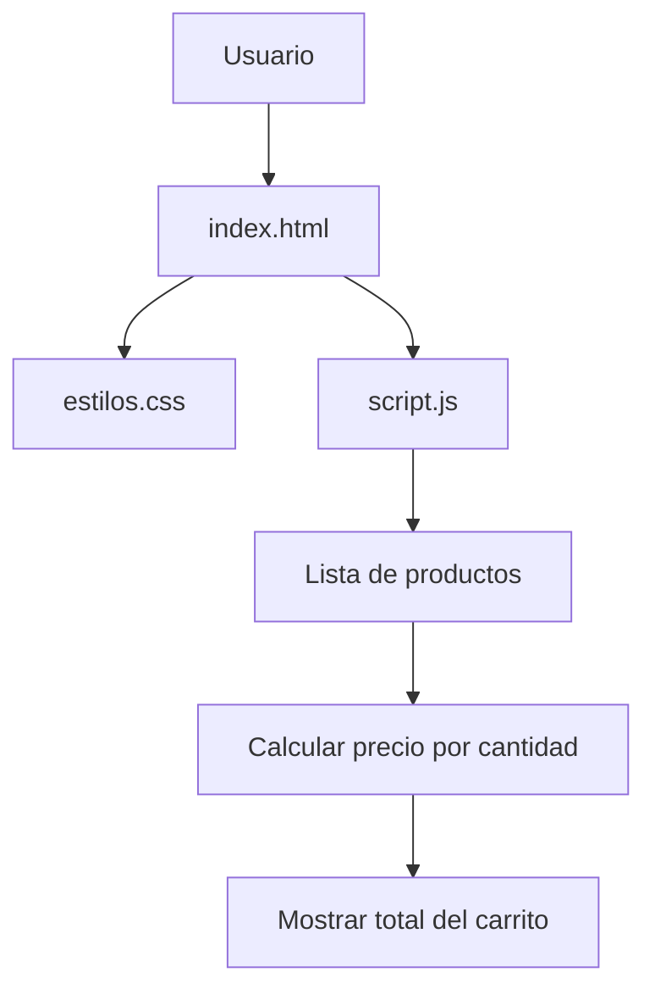

### Tienda TECSUP

   


### Descripción

Tienda TECSUP es un proyecto web que simula un carrito de compras, permitiendo visualizar productos, cantidades y precios. Está desarrollado con HTML, CSS y JavaScript para practicar la programación y el trabajo colaborativo con Git y GitHub.

### Tabla de contenidos

- [Descripción](#descripción)
- [Tecnologías](#tecnologías)
- [Instalación](#instalación)
- [Uso](#uso)
- [Funciones principales](#funciones-principales)
- [Ejemplos de código](#ejemplos-de-código)
- [Hoja de ruta](#hoja-de-ruta)
- [Arquitectura](#arquitectura)
- [Contribuciones](#contribuciones)
- [Licencia](#licencia)

### Tecnologías

Tecnología| Uso
HTML5| Estructura de la página
CSS3| Diseño y estilos
JavaScript| Cálculos del carrito
Git| Control de versiones
GitHub| Repositorio remoto

### Instalación

1. Clonar el repositorio:

git clone https://github.com/mariaquispev-dot/tarea.git

2. Ingresar a la carpeta:

cd tarea

3. Abrir el archivo "index.html" en el navegador.

Uso

1. Abrir la página principal.
2. Visualizar los productos disponibles.
3. Revisar las cantidades y precios.
4. Comprobar el total del carrito.

### Funciones principales

Función| Descripción
calcularTotal()| Calcula el importe total
Multiplicar precio| Considera el precio por cantidad
Mostrar carrito| Presenta los productos y sus importes


### Código JavaScript

```javascript
function calcularTotal(lista) {
    let total = 0;

    for (const producto of lista) {
        total += producto.precio * producto.cantidad;
    }

    return total;
}
```

```html 

<h1>Tienda TECSUP</h1>
<table>
    <tr>
        <th>Producto</th>
        <th>Precio</th>
        <th>Cantidad</th>
    </tr>
</table>
```

### Hoja de ruta

- [x] Crear la estructura HTML.
- [x] Diseñar la página con CSS.
- [x] Corregir el cálculo del carrito.
- [x] Corregir la referencia de los estilos.
- [x] Trabajar con Issues y Pull Requests.
- [ ] Incorporar nuevas funcionalidades.
- [ ] Mejorar el diseño de la tienda.

### Arquitectura
El funcionamiento de tienda TECSUP se organiza de la siguiente manera: 



### Contribuciones

Las personas interesadas en colaborar pueden revisar las instrucciones del archivo "CONTRIBUTING.md" (CONTRIBUTING.md).

📄 Licencia

Este proyecto utiliza la licencia MIT.

---

Desarrollado como parte del Laboratorio N.º 3 – Trabajo colaborativo con repositorios remotos.